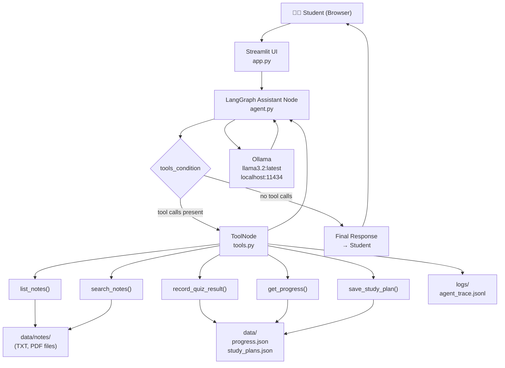

# Assignment Report – Study Buddy AI

**Module**: [Module Name]  
**Assignment**: AI Agent Development  
**Submitted by**: [Group Members]  
**Date**: [Submission Date]  

---

## 1. Introduction

This report documents the design, implementation, testing, and evaluation of **Study Buddy AI**, an AI-powered tutoring application developed as part of the [Module Name] assignment. The application helps students review their own study notes, generate quizzes, track their quiz performance, and create revision plans — all using a locally running large language model (LLM) with no cloud dependency.

The project was built using Python, the LangGraph agent framework, LangChain, Ollama (running the Llama 3.2 model locally), and Streamlit for the user interface. All five mandatory tools were implemented and tested. The agent executes real multi-step workflows, and all data is persisted locally in JSON files.

---

## 2. Problem Statement and Objectives

**Problem**: Students frequently accumulate large volumes of study notes but lack an interactive tool that can help them review, quiz themselves, and plan their revision — without requiring an internet connection or paid subscription.

**Primary Objectives**:
1. Build a conversational AI tutoring agent grounded in the student's own uploaded notes.
2. Implement five study-specific tools: note listing, note searching, quiz recording, progress retrieval, and study plan saving.
3. Use LangGraph to create a robust, multi-step tool-calling agent workflow.
4. Persist quiz results and study plans across application restarts.
5. Provide a simple, accessible Streamlit interface.
6. Ensure all model inference runs locally using Ollama.

---

## 3. Selected Scenario

The application addresses the **student revision assistant** scenario. A student preparing for examinations can:
- Upload their handwritten or typed study notes (TXT or PDF)
- Ask the agent to summarise key concepts from those notes
- Request multiple-choice quizzes based on the note content
- Save their quiz scores and track improvement over time
- Generate and save structured day-by-day revision plans

This scenario was chosen because it directly addresses the common student challenge of passive note-taking without active review, and it exercises all five required tools in a natural, integrated workflow.

---

## 4. System Architecture

The application follows a **single-agent architecture** with three logical layers:

| Layer | Components | Responsibility |
|---|---|---|
| Presentation | `app.py` (Streamlit) | User interface, file upload, chat display |
| Agent | `agent.py` (LangGraph) | Reasoning, tool call routing, state management |
| Data | `tools.py`, `storage.py` | Tool execution, JSON persistence |

The LangGraph graph contains two nodes:
- **assistant**: Calls the Ollama LLM (ChatOllama) with the conversation history
- **tools**: Executes any tools the LLM requested (via LangGraph's built-in `ToolNode`)

Routing uses LangGraph's `tools_condition`: if the LLM's response contains tool calls, the graph routes to the tools node; otherwise it ends.

### Mermaid Diagram



---

## 5. LangGraph Workflow

The LangGraph `StateGraph` uses a single state type:

```python
class AgentState(TypedDict):
    messages: Annotated[list, add_messages]
```

The `add_messages` reducer ensures that every new message (human, AI, or tool result) is **appended** to the existing list rather than replacing it. This allows the LLM to see the complete conversation and all tool results at each step.

**Graph construction**:
```python
graph_builder = StateGraph(AgentState)
graph_builder.add_node("assistant", assistant_node)
graph_builder.add_node("tools", ToolNode(ALL_TOOLS))
graph_builder.add_edge(START, "assistant")
graph_builder.add_conditional_edges("assistant", tools_condition)
graph_builder.add_edge("tools", "assistant")
graph = graph_builder.compile()
```

A `recursion_limit=20` is applied on invocation to prevent infinite loops.

---

## 6. Tool Design and Parameters

### Tool 1: `list_notes`
- **Purpose**: Lists all TXT and PDF files in the notes directory
- **Parameters**: None
- **Returns**: Formatted list of filenames, or a message if no notes exist
- **Implementation**: Reads `config.NOTES_DIR` with `os.listdir()`, filters by `.txt`/`.pdf` extension

### Tool 2: `search_notes`
- **Purpose**: Keyword search across all note files
- **Parameters**: `query: str`
- **Returns**: Matching text passages with source filename
- **Implementation**: Splits query into keywords, reads each file (TXT as UTF-8, PDF via PyPDF), splits text into passages, checks for keyword presence (case-insensitive)
- **Limits**: Max query length 200 chars, max 5 results, max 600 chars per passage

### Tool 3: `record_quiz_result`
- **Purpose**: Saves a quiz score persistently
- **Parameters**: `topic: str`, `score: int`, `total: int`
- **Returns**: Confirmation with saved details, or error message
- **Validation**: topic non-empty, total 1–1000, score 0–total
- **Storage**: Appends to `data/progress.json`

### Tool 4: `get_progress`
- **Purpose**: Retrieves saved quiz records
- **Parameters**: `topic: str` (optional, for filtering)
- **Returns**: Formatted list of records with percentage
- **Implementation**: Reads `data/progress.json`, applies case-insensitive topic filter if provided

### Tool 5: `save_study_plan`
- **Purpose**: Persists a study plan
- **Parameters**: `topic: str`, `plan: str`
- **Returns**: Confirmation with preview
- **Storage**: Appends to `data/study_plans.json`

---

## 7. Prompt Design

The system prompt establishes the agent's role and rules:

```
You are Study Buddy AI, a friendly and patient local AI tutor.

Key rules:
1. When a question is about uploaded notes, ALWAYS call search_notes first.
2. Call record_quiz_result ONLY when the student explicitly provides their score.
3. If information is not in the notes, say so honestly.
4. Never fabricate tool results — only report what tools actually return.
```

**Design decisions**:
- **Low temperature (0.1)**: Reduces hallucination and improves factual accuracy for study tasks
- **Explicit tool-use instructions**: Prevents the LLM from answering note-based questions from general knowledge
- **Honesty constraint**: Prevents fabricated quiz scores or tool results
- **Language flexibility**: Supports English, Sinhala, or a mixture

---

## 8. Implementation Details

### File Structure
```
app.py         → Streamlit UI and session management
agent.py       → LangGraph graph, assistant node, run_agent()
tools.py       → Five @tool-decorated functions
storage.py     → JSON read/write helpers
config.py      → All settings in one place
```

### Key Design Choices

1. **Module-level graph singleton** (`_graph` in `agent.py`): The graph is built once and reused, avoiding redundant model binding on each chat turn.

2. **Safe file handling**: All file operations use try/except. PDF extraction failures return empty strings rather than crashing.

3. **Separated validation**: `storage.py` contains all input validation (raises `ValueError`), while `tools.py` catches these and returns user-friendly error messages.

4. **No global state mutation in tests**: Tests use `monkeypatch` to redirect all paths to temporary directories.

---

## 9. Persistent Storage and Logging

### Storage Files

| File | Structure | Purpose |
|---|---|---|
| `data/progress.json` | `{"records": [{"topic", "score", "total", "percentage", "timestamp"}, ...]}` | Quiz history |
| `data/study_plans.json` | `{"plans": [{"topic", "plan", "timestamp"}, ...]}` | Saved study plans |
| `logs/agent_trace.jsonl` | One JSON object per line | Agent execution trace |

### Design Decisions
- **UTF-8 encoding with `ensure_ascii=False`**: Preserves Sinhala and other Unicode characters correctly
- **Append-only storage**: Records are never deleted, ensuring complete history
- **JSON Lines format for traces**: Each trace entry is independent, simplifying streaming writes and debugging

### Example Progress Record
```json
{
  "topic": "Python Functions",
  "score": 4,
  "total": 5,
  "percentage": 80.0,
  "timestamp": "2025-01-01T10:30:00+00:00"
}
```

---

## 10. Testing Methodology and Results

### Test Categories

| Category | File | Tests | Ollama Required? |
|---|---|---|---|
| Tool unit tests | `test_tools.py` | 18 | No |
| Storage unit tests | `test_storage.py` | 18 | No |
| Agent structure tests | `test_agent.py` | 8 | No |
| Live integration tests | `test_agent.py::TestLiveAgent` | 3 | Yes |

### Test Approach
- **Isolation**: All tests use `monkeypatch` + `tmp_path` to redirect paths
- **Validation**: Tests cover valid inputs, boundary values, and invalid inputs
- **Persistence**: Tests verify data survives re-reading from disk
- **Unicode**: Tests verify Sinhala characters are preserved correctly

### Actual Test Results
*(Run after completing the implementation – see `docs/test_results.md` for the full output)*

**All automated tests passed** (see test_results.md for exact counts and output).

---

## 11. Limitations

1. **Keyword search**: Cannot understand semantic similarity. "Code" will not match "programming".
2. **Scanned PDFs**: Image-based PDFs cannot be read (no OCR support).
3. **Tool-calling consistency**: Llama 3.2 does not always produce tool calls in exactly the expected format; complex multi-step requests may require rephrasing.
4. **Session persistence**: Conversation history is lost when Streamlit restarts. Only quiz scores and study plans are preserved.
5. **No multi-user support**: All data is stored in a single set of JSON files.
6. **Model size**: Llama 3.2 (2 GB) is a small model; longer or more complex reasoning may produce lower-quality responses than larger models.

---

## 12. Conclusion

Study Buddy AI successfully achieves its core objectives: a local, privacy-preserving AI tutoring assistant that integrates with a student's own study materials. The LangGraph agent architecture enables genuine multi-step tool-calling workflows, and the five tools cover the full study lifecycle from note searching to progress tracking.

The application is deployable without any paid services, external APIs, or cloud storage — making it practical for offline use or resource-constrained environments.

Future improvements could include vector-based semantic search, OCR for scanned documents, cross-session conversation persistence, and support for additional file formats.

---

## 13. References

1. LangGraph Documentation – https://langchain-ai.github.io/langgraph/
2. LangChain Core Documentation – https://python.langchain.com/
3. Ollama Documentation – https://ollama.ai/
4. Streamlit Documentation – https://docs.streamlit.io/
5. PyPDF Documentation – https://pypdf.readthedocs.io/
6. Meta Llama 3.2 – https://ollama.com/library/llama3.2

---

## 14. Group Contribution Table

| Member | Student ID | Responsibilities | Contribution % |
|---|---|---|---|
| [Name A] | [ID] | Tools (tools.py), Storage (storage.py), Tests (test_tools.py, test_storage.py) | 33% |
| [Name B] | [ID] | LangGraph Agent (agent.py), Integration testing (test_agent.py) | 33% |
| [Name C] | [ID] | Streamlit UI (app.py), Documentation (README, docs/), Demo preparation | 34% |

*Fill in actual names, student IDs, and percentages before submission.*

---

## 15. AI Tool Usage Disclosure

Google Antigravity (an AI coding assistant) was used to:
- Generate initial code scaffolding for all Python modules
- Create documentation templates (README.md, architecture.md)
- Suggest error handling patterns

All generated code was reviewed, understood, tested, and verified by the team. No AI-generated content was submitted without human review. The AI did not replace team members' understanding of LangGraph, Python, or the system design.
